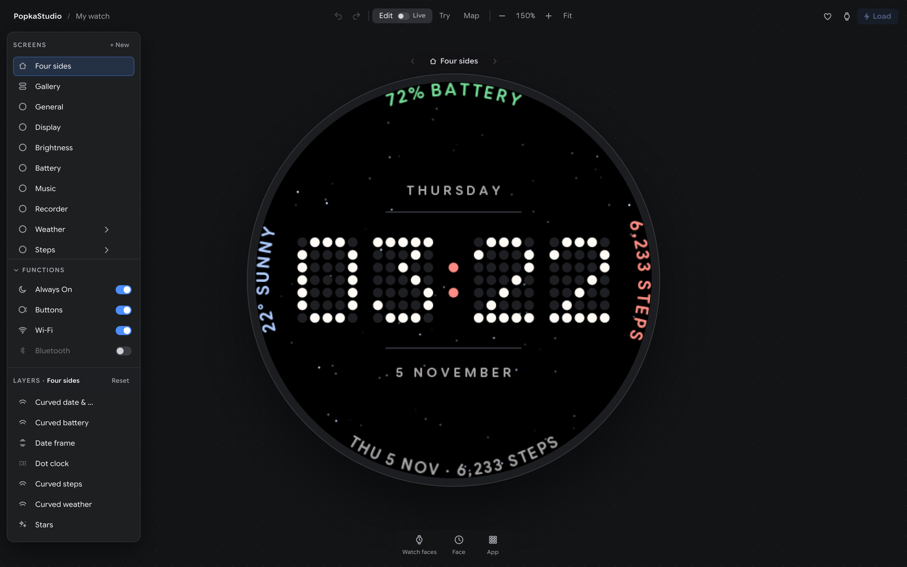
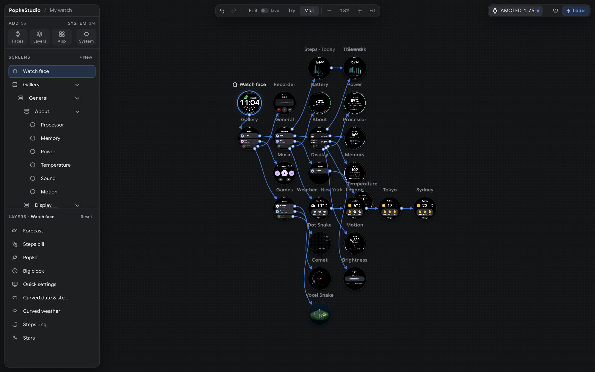
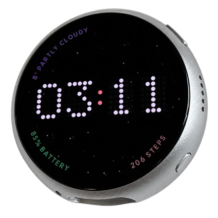
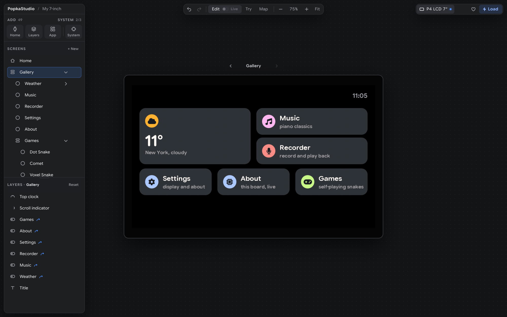
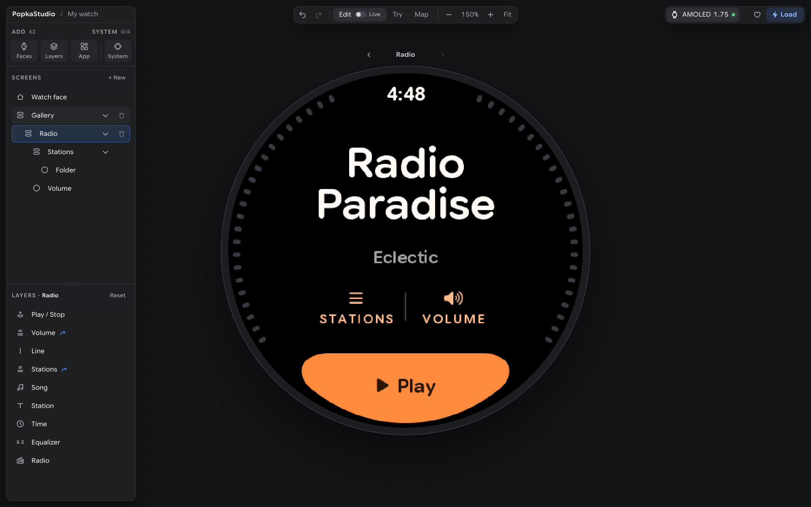
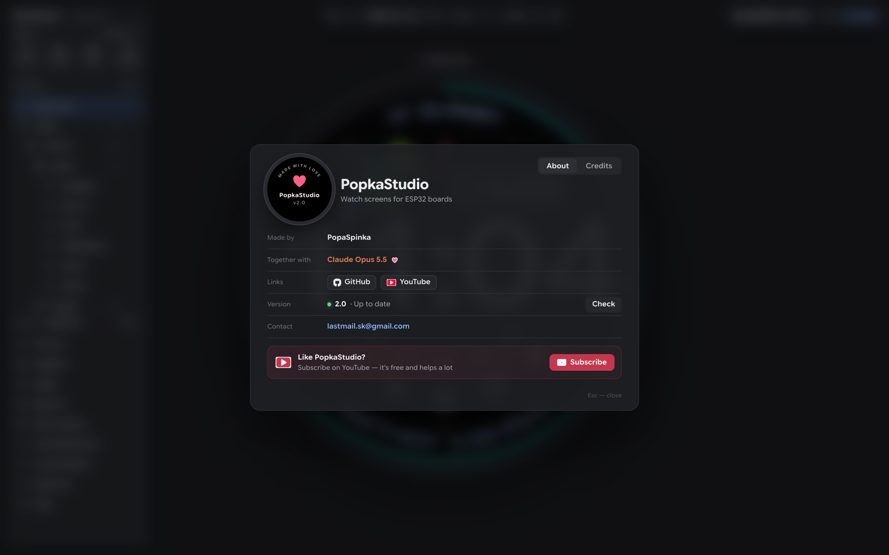

# PopkaStudio

**Design watch screens for ESP32 boards in your browser — and see them on the real watch in one click.**

[Русская версия](README.ru.md) · [Video: how it started (YouTube)](https://www.youtube.com/watch?v=NHNoKUa2cDg)



PopkaStudio is a visual editor for screen interfaces on ESP32 boards — a round 1.75″ watch and, new in 2.0, a 7″
ESP32-P4 display. You put together a watch face, apps and screens from ready parts, link them like frames in Figma, and
press **Load** — the board gets firmware built from exactly what you made, running smoothly at 60 frames per second.

The preview is not a mock-up: it is **the board's own code**, compiled to WebAssembly. What you see in the editor is
what the watch shows, pixel for pixel — the same fonts, the same animations, the same touch.

## What it can do

- **Watch faces from layers** — sixteen clock styles (Hairline, LCD, Neon, Flip, Comet, Hands and more), a dot
  clock, date lines, curved text along the edge, weather, steps, battery, forecast, a starry sky with meteors, pixel
  art (meet **Popka**, the parrot). Move, resize, recolor everything; any number of copies.
- **Apps** — a gallery of cards (as on modern smartwatches), Weather with real data and several cities, Steps (the
  motion chip's own pedometer), Display brightness, Battery, a Music player, a voice Recorder, three self-playing
  snake games, and About and Power — live cards about the board itself (processor, memory, battery, temperature,
  sound, motion; voltages).
- **Radio** (round watch, new in 2.1) — internet radio over Wi-Fi: tens of thousands of free stations from the
  [Radio Browser](https://www.radio-browser.info) catalog in folders (Top, genres, countries), favorites with a heart,
  the song that's playing, and an equalizer of rays along the edge that dances to the real sound. In the editor its
  screen is made of layers — move, recolor, resize or hide every part.
- **Quick settings** — swipe down on the home screen: brightness, volume, Wi-Fi, Always On, lock, screen off — all
  real. One look on the round watch, four on the 7″ board, with app shortcuts and the player.
- **Video** (7″ board) — clips from a microSD card, decoded in hardware, or straight from your computer over Wi-Fi with
  **Stream**. Add a clip with **+**: PopkaStudio converts it (needs [ffmpeg](https://ffmpeg.org)) and writes it to the
  card.
- **A map of screens** — every screen at once, links drawn as curves; tap a card or a layer to open a screen, with
  transitions.
- **Try** — use the watch right in the editor, the mouse as your finger.
- **Live** — with the board on USB, moves and colors change on the watch as you drag them, no Load needed.
- **It knows your board** — the dot next to the board's name: green — this project is on it, blue — PopkaStudio
  firmware from another project or an older version, yellow — someone else's firmware. **Check the board** reads it
  without writing anything; **Save its firmware** keeps a copy of someone else's firmware before your first Load.
- **System** — Always On display, what the side buttons do (screen off, lock), waking up by touch, raising your
  wrist or a button, Wi-Fi (exact time and fresh weather), Bluetooth: one tile, a menu with how each is set, the
  switches and settings in the right card.
- **Only what you add gets in.** A layer you don't use isn't in the firmware at all — no code, no fonts, sensors off.



## The boards

- [Waveshare ESP32-S3-Touch-AMOLED-1.75C](https://www.waveshare.com/esp32-s3-touch-amoled-1.75c.htm): a round 1.75″
  AMOLED, 466 × 466, touch, a motion sensor, a speaker and microphones.
- [Waveshare ESP32-P4-WIFI6-Touch-LCD-7B](https://www.waveshare.com/esp32-p4-wifi6-touch-lcd-7b.htm) (new in 2.0): a 7″
  screen, 1024 × 600, touch, Wi-Fi 6 through its ESP32-C6, a speaker, microphones and a microSD card slot. Its
  screens are laid out for a wide display — a grid gallery, weather with a chart, a home screen with the date and the
  weather along the top — and its transitions are short and calm. Both chip revisions (v1.x and v3) are recognized by
  themselves.

Choose the board when you create a project; each project is for one board.





## Install — macOS and Linux

One command:

```bash
curl -fsSL https://raw.githubusercontent.com/PopaSpinka/PopkaStudio/main/install.sh | bash
```

Prefer to look first? `git clone https://github.com/PopaSpinka/PopkaStudio.git`, read `install.sh`, run
`./install.sh`.

It puts everything into the PopkaStudio folder (`~/PopkaStudio`), nothing system-wide: its own Python with numpy,
Pillow and pyserial ([uv](https://docs.astral.sh/uv/)), [arduino-cli](https://arduino.github.io/arduino-cli/) with
the ESP32 core 3.3.11, and the fonts. The ESP32 tools are the big part: 1.5–3 GB, 5–20 minutes the first time. On
Linux it asks for your password once, to let you use the USB port (then log out and back in).

Then:

```bash
popkastudio
```

It opens **http://localhost:8466**.

**Updates:** when a new version is out, a blue number appears on the heart at the top right — how many updates
since yours. Click it to see what's new in each one, then **Update**: PopkaStudio updates itself and restarts, and you
**Load** your project again. The heart's window shows your version too, and its **Check** button checks right away.
(Running `install.sh` again updates too.)

Windows is not supported.

## First steps

1. **Choose a board**, then **New** — a project. It starts as an empty black watch face: you add only what you need.
2. Add parts from the folders at the top of the left card (**ADD**): **Faces** (a whole face), **Layers** (its
   parts), **App**. A tile with a green frame is already in your project. Next to them, **System** — Always On, the
   buttons, Wi-Fi and Bluetooth.
3. Connect the board with a USB-C cable and press **Load** (top right). The first Load builds everything and takes a
   minute or two; the next ones are faster.

Wi-Fi is off in a new project — the clock takes its time from your computer at each Load. Choose **From: Wi-Fi** for
a clock's time or pick a weather city, and the Wi-Fi window lists the networks your board sees.

Your projects are saved on your computer (`projects/`). The Wi-Fi password stays on your computer too
(`studio/secrets/`) and goes only into the firmware it builds.

To go back to the firmware that was on the board, use the copy from **Save its firmware** (`studio/backups/`,
with `restore.txt`), or see [Waveshare's examples](https://github.com/waveshareteam/ESP32-S3-Touch-AMOLED-1.75C) for
the factory demo.

## Trouble?

- **No board in the list** — try another cable (some carry only power). Linux: did you log out and back in after
  installing? Ubuntu's ModemManager can grab the port: `sudo systemctl stop ModemManager`.
- **Load can't reach the board** — PopkaStudio shows how: hold **BOOT**, plug the cable in again, then **Load
  again**.
- **Load failed** — the log is under the Load button; open an [issue](https://github.com/PopaSpinka/PopkaStudio/issues)
  with it.
- **The board hangs** — hold PWR for 8–10 seconds, then turn it on again.

## Privacy

No accounts, no telemetry. The editor talks only to [Open-Meteo](https://open-meteo.com) (the weather for the cities
you pick), [Zippopotam.us](https://zippopotam.us) (when you look up a US ZIP code) and GitHub — at most once an hour, for
the list of PopkaStudio's releases (the same request any browser makes; nothing about you is sent). The watch connects to
your Wi-Fi only for the time, the weather and the radio, and only if you turn Wi-Fi on. **Radio** asks the
[Radio Browser](https://www.radio-browser.info) catalog for its lists of stations, tells it when you start one of its
stations (an anonymous count of listens, as the catalog asks its apps to), and plays the stream straight from the
station's own server. **Stream** (the 7″ board's Video), while
it's on, lets your board download the clips of one folder from your computer over your local network — nothing else,
nothing written.

## Radio stations



PopkaStudio stores, records and rebroadcasts no audio. **Radio** is a player: you pick stations from the
[Radio Browser](https://www.radio-browser.info) community directory or add your own, and the watch plays each stream
straight from the broadcaster's server, as any internet radio does. A new project starts with stations whose
broadcasters publish their links for other players: [Radio Paradise](https://radioparadise.com/listen/stream-links)
(four mixes), Radio Swiss Classic and Radio Swiss Jazz.

Station names, programs and music belong to the stations and their rights holders; PopkaStudio is not affiliated with
or endorsed by any of them. Each broadcaster's own terms apply to your listening, and some allow personal use only.
Broadcasters: to have your station taken out of the defaults (or put in), open an
[issue](https://github.com/PopaSpinka/PopkaStudio/issues) or write to **lastmail.sk@gmail.com**.

## Plans

I'm going to keep developing PopkaStudio — I love ESP32 boards and devices like them, and making beautiful
interfaces for them that run flawlessly at 60 fps and more.

- More boards: other round and square screens after the 7″ ESP32-P4.
- Your own GIF or video clip as a pixel-art layer, in seconds.
- More apps and widgets, more watch faces.
- Even smoother motion and longer battery life.

**Like PopkaStudio?** Subscribing to [the YouTube channel](https://www.youtube.com/@PopaSpinka?sub_confirmation=1) is
free and helps a lot — there's a button for it in the heart's window too.

**Board makers:** want your board in PopkaStudio and the Halo library, tuned for smooth 60+ fps? Write to
**lastmail.sk@gmail.com**.

## License

[PolyForm Noncommercial 1.0.0](LICENSE): **free for personal, hobby, educational and other noncommercial use.**
Selling devices, firmware, faces or services made with PopkaStudio or Halo needs a commercial license — see
[COMMERCIAL.md](COMMERCIAL.md). The watches you design are yours.

## Credits



Made by **[PopaSpinka](https://github.com/PopaSpinka)** together with **Claude Opus 5.5** (Anthropic) — every screen,
every spring, every pixel. Thank you, Claude.

The code is written from scratch. The motion follows published open-source numbers, no firmware or app was
decompiled, and no code was taken from GPL projects:

| Source | License | What was used |
| --- | --- | --- |
| [androidx](https://github.com/androidx/androidx) — Compose for Wear OS | Apache 2.0 | spring stiffness and damping, durations and easing curves, how cards shrink at the edge, swipe back |
| [Horologist](https://github.com/google/horologist) | Apache 2.0 | the player: sizes, the progress ring, icon timing |
| [wear-os-samples](https://github.com/android/wear-os-samples) | Apache 2.0 | how a screen is put together from components |
| [PebbleOS](https://github.com/coredevices/PebbleOS) | Apache 2.0 | screen transitions on a microcontroller |
| [Material Components for Android](https://github.com/material-components/material-components-android) | Apache 2.0 | the 7″ board's transitions: the shared axis — its time, distance and easing |

Third-party parts:

| What | Author | License |
| --- | --- | --- |
| Google Sans Flex font (downloaded by the installer; glyphs rendered into the firmware) | Google | [SIL OFL 1.1](https://openfontlicense.org) |
| Instrument Serif and JetBrains Mono fonts (the Serif and Terminal clocks; downloaded when first used, glyphs rendered into the firmware) | Instrument; JetBrains | [SIL OFL 1.1](https://openfontlicense.org) |
| Nunito font (Cyrillic letters in Radio; downloaded when first used, glyphs rendered into the firmware) | Vernon Adams, Jacques Le Bailly | [SIL OFL 1.1](https://openfontlicense.org) |
| Radio station catalog | [Radio Browser](https://www.radio-browser.info) community | free API, for free and non-free software |
| Helix MP3 decoder (Radio; part of the ESP32 Arduino core, not in this repository) | RealNetworks; [esp-libhelix-mp3](https://github.com/chmorgan/esp-libhelix-mp3) | RPSL 1.0 / RCSL |
| Font Awesome Free icons (downloaded by the installer; rendered into the firmware) | Fonticons, Inc. | [CC BY 4.0](https://fontawesome.com/license/free) |
| Weather data | [Open-Meteo.com](https://open-meteo.com) | [CC BY 4.0](https://creativecommons.org/licenses/by/4.0/) |
| US ZIP code lookup | [Zippopotam.us](https://zippopotam.us) | free API |
| ES8311 codec register sequence (`lib/Halo/src/halo_audio.cpp`) | based on Espressif's es8311 driver | Apache 2.0 |
| Board pins and display start-up sequence | based on [Waveshare's examples](https://github.com/waveshareteam/ESP32-S3-Touch-AMOLED-1.75C) | Apache 2.0 |
| [ArduinoJson](https://arduinojson.org) (`lib/ArduinoJson`) | Benoît Blanchon | MIT |
| [Emscripten](https://emscripten.org) runtime (`studio/web/build`) | Emscripten authors | MIT |
| [Electron](https://www.electronjs.org) (the optional Mac app) | OpenJS Foundation | MIT |
| Music — 20-second excerpts of [Musopen](https://musopen.org) recordings | see [firmware/music](firmware/music/README.md) | public domain, CC0 |
| The board photo | PopaSpinka | part of this repository |

PopkaStudio is an independent project, not affiliated with or endorsed by Google, Espressif or Waveshare. Wear OS and
Android are trademarks of Google LLC; ESP32 is a trademark of Espressif Systems; Waveshare is a trademark of Waveshare
Electronics.
