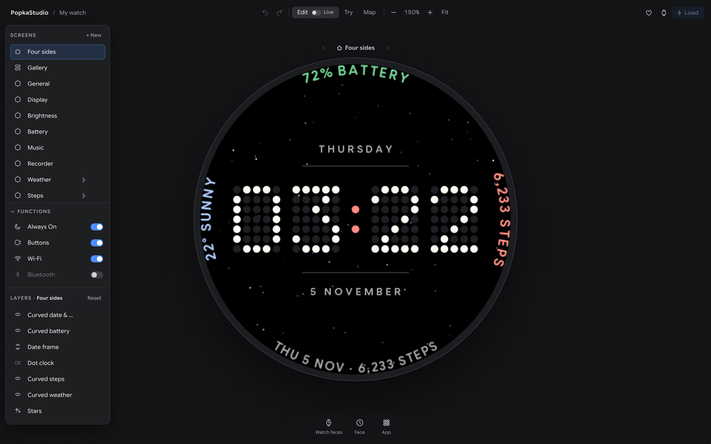
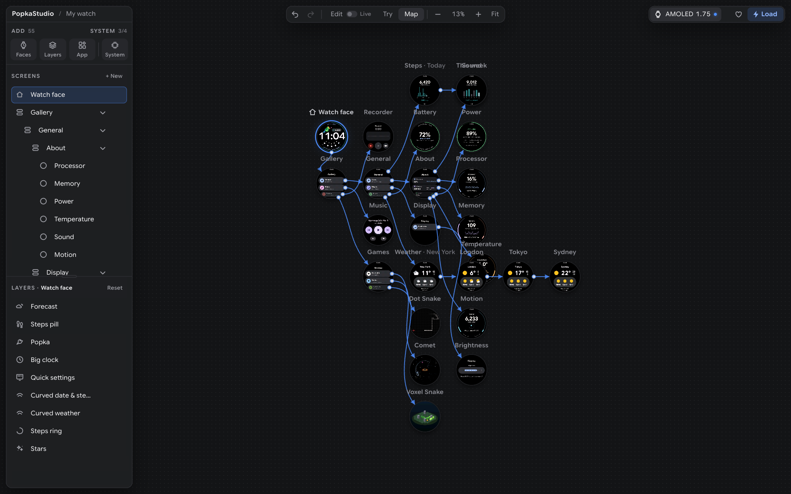
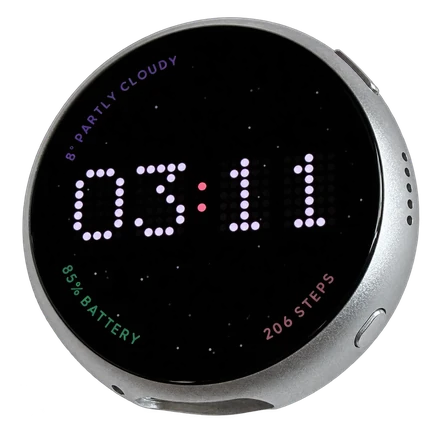
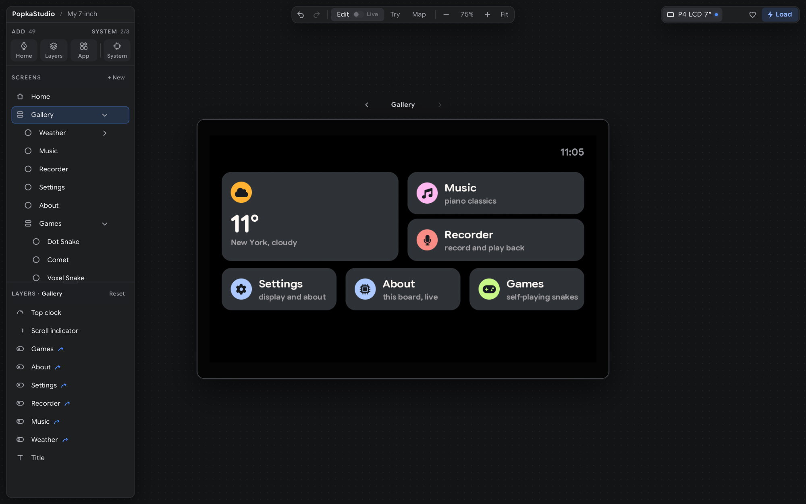
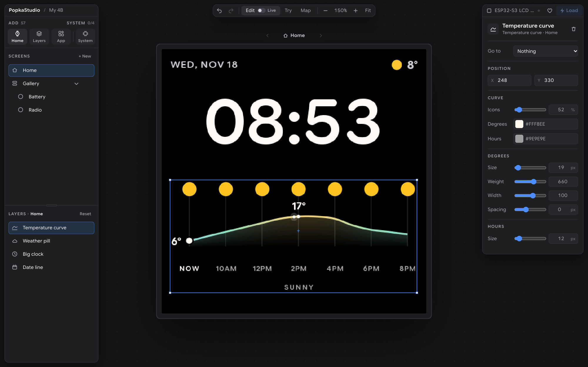
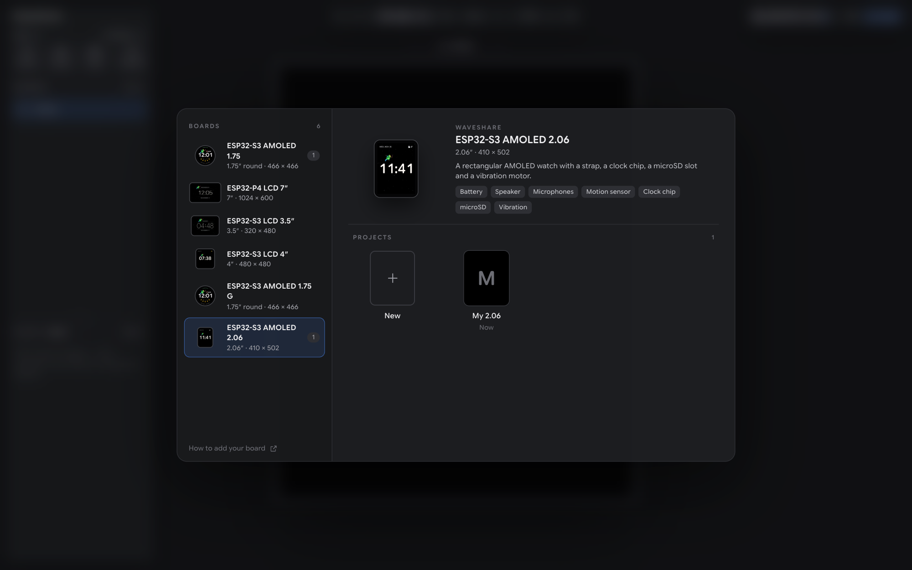
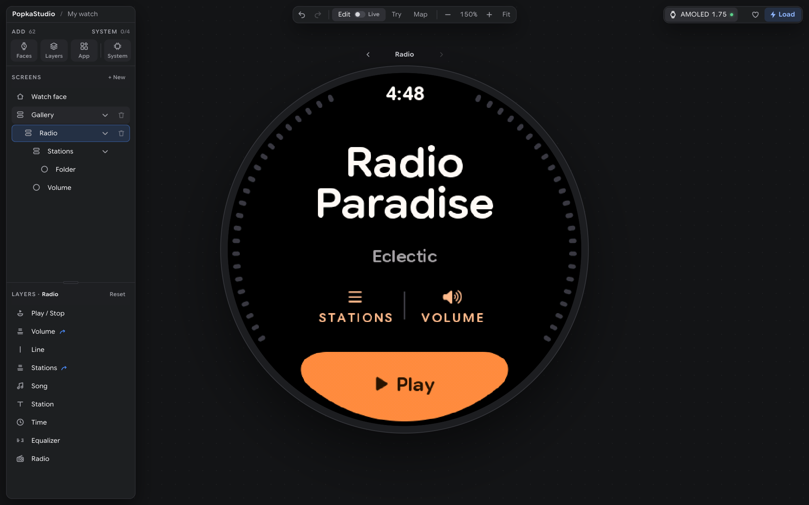
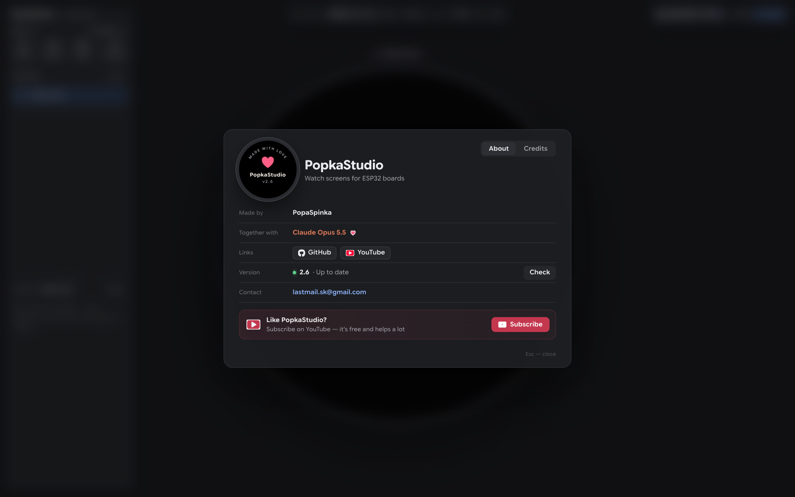

# PopkaStudio

**Экраны часов для плат ESP32 — рисуешь в браузере, на настоящих часах — одной кнопкой.**

[English](README.md) · [Видео: с чего всё началось (YouTube)](https://www.youtube.com/watch?v=NHNoKUa2cDg) ·
[Поддержать проект](#поддержать-проект)



PopkaStudio — редактор интерфейсов для экранов на платах ESP32: круглые часы 1,75″, экран 7″ на ESP32-P4,
квадратный экран 4″, часы-прямоугольник 2,06″ и, от сообщества, WT32-SC01 Plus с экраном 3,5″. Собираешь циферблат, приложения и экраны из готовых частей, связываешь их, как кадры в Figma, и жмёшь
**Load** — плата получает прошивку ровно из того, что ты сделал, и работает плавно, 60 кадров в секунду.

Превью — не картинка-макет, а **код самой платы**, собранный в WebAssembly. Что видно в редакторе, то и на часах,
пиксель в пиксель: те же шрифты, те же анимации, то же касание.

## Что умеет

- **Циферблаты из слоёв** — часы шестнадцати видов (Hairline, LCD, Neon, Flip, Comet, Hands и другие), часы из
  точек, даты, надписи по дуге у края, погода, шаги, заряд, прогноз, звёздное небо с метеорами, пиксель-арт
  (знакомьтесь — **Попка**, попугай). Всё двигается, меняет размер и цвет; копий — сколько угодно.
- **Приложения** — галерея карточек (как на современных часах), снизу или сбоку, погода по-настоящему и для нескольких городов, шаги
  (шагомер самого датчика движения), яркость, батарея, музыкальный плеер, диктофон, три змейки, которые играют сами,
  и About и Power — живые карточки о самой плате (процессор, память, батарея, температура, звук, движение; напряжения).
- **Pomodoro** (новое в 2.6, от [YKatrechko](https://github.com/YKatrechko)) — таймер фокуса на всех платах:
  интервалы фокуса и перерывы, длинный перерыв после каждых четырёх, Skip, Reset и Auto-start, три гудка в конце
  интервала, свои настройки на самих часах. На круглых часах оставшееся время бежит по кольцу у края, на
  прямоугольнике — по рамке экрана.
- **Агент** (новое в 2.7) — лицо для голосового помощника на всех платах: **лицо из точек** (табло 29 × 29 точек,
  как у точечной змейки: радуется, смеётся, злится, грустит, влюблён, не понял, испугался, готово…) или **шар из
  точек** (340 точек на шаре: слушает, думает, ищет, говорит, радуется, злится, ошибка, спит…), по двенадцать
  настроений или все по очереди. Касание — следующее настроение; команда `agent` по USB ставит его, так что лицом
  может управлять свой помощник. Круглый на всех платах — на прямоугольнике круг посередине. Шар вдохновлён
  [Thinking Orbs](https://github.com/yogesharc/thinking-orbs) (MIT), код свой.
- **Виджеты погоды** (новое в 2.2) — огромная температура с живым небом внутри цифр, 12 часов вперёд кривой,
  старинный барометр, что надеть, персонаж по погоде, пиксельная погода, дни вперёд. Большие часы сами уступают им
  место; на прямоугольных платах у каждого две раскладки.
- **Радио** (круглые часы, плата 7″, квадрат 4″) — интернет-радио по Wi-Fi: десятки тысяч бесплатных станций из
  каталога [Radio Browser](https://www.radio-browser.info) по папкам (Top, жанры, страны), избранное сердечком,
  название песни, которая играет. На круглых часах — эквалайзер лучами по краю, который пляшет под настоящий звук, и
  экран из слоёв: каждую часть можно сдвинуть, перекрасить, увеличить или спрятать; на плате 7″ — один экран с двумя
  ручками, громкости и настройки, как у настоящего приёмника; на квадрате 4″ — высокое окно настройки и крупные кнопки.
- **Быстрые настройки** — свайп вниз по главному экрану: яркость, громкость, Wi-Fi, Always On, блокировка, погасить
  экран — всё настоящее. На круглых часах один вид, на плате 7″ — четыре, с ярлыками приложений и плеером, на квадрате 4″ — полоса.
- **Видео** (плата 7″) — ролики с карты microSD, декодирование железом, или прямо с компьютера по Wi-Fi —
  **Stream**. Ролик добавляется кнопкой **+**: PopkaStudio сама его переделает (нужен [ffmpeg](https://ffmpeg.org)) и
  запишет на карту.
- **Карта экранов** — все экраны сразу, связи — линиями; нажатие на карточку или слой открывает экран, с переходом.
- **Try** — пользуйся часами прямо в редакторе, мышь вместо пальца.
- **Live** — плата на USB: двигаешь и красишь — на часах меняется сразу, без Load.
- **Узнаёт плату** — точка у имени платы: зелёная — на ней этот проект, синяя — прошивка PopkaStudio из другого
  проекта или старой версии, жёлтая — чужая прошивка. **Check the board** читает плату, ничего не записывая;
  **Save its firmware** сохраняет копию чужой прошивки перед первым Load.
- **System** — Always On, что делают боковые кнопки (погасить, заблокировать), чем будить: касанием, поднятием руки,
  кнопкой; Wi-Fi (точное время и свежая погода), Bluetooth. Одна плитка, меню с тем, как что настроено,
  переключатели и настройки — в правой карточке.
- **В прошивку попадает только добавленное.** Что не используешь — того в прошивке нет совсем: ни кода, ни шрифтов,
  датчики выключены.
- **macOS, Linux и Windows** (Windows — новое в 2.8, от [wufwufmakc](https://github.com/wufwufmakc)) — редактор
  — страница в браузере; маленький помощник на компьютере собирает прошивку и пишет её по USB.



## Платы

- [Waveshare ESP32-S3-Touch-AMOLED-1.75C](https://www.waveshare.com/esp32-s3-touch-amoled-1.75c.htm): круглый AMOLED
  1,75″, 466 × 466, тач, датчик движения, динамик и микрофоны.
- [Waveshare ESP32-P4-WIFI6-Touch-LCD-7B](https://www.waveshare.com/esp32-p4-wifi6-touch-lcd-7b.htm) (новая в 2.0):
  экран 7″, 1024 × 600, тач, Wi-Fi 6 через её ESP32-C6, динамик, микрофоны и слот для карты microSD. Экраны для неё
  разложены под широкий дисплей — галерея сеткой, погода с графиком, главный экран с датой и погодой сверху, — а
  переходы короткие и спокойные. Обе ревизии чипа (v1.x и v3) студия узнаёт сама. Новое в 2.2: её можно держать и
  **вертикально** (600 × 1024, USB снизу) — у каждого экрана своя вертикальная раскладка; горизонтально или вертикально —
  выбирается при создании проекта (видео пока только горизонтально).
- [Wireless-Tag WT32-SC01 Plus](https://www.seeedstudio.com/ESP32-Development-board-WT32-SC01-p-4735.html) (новая в 2.2,
  **плата сообщества** от [dimonmontana](https://github.com/dimonmontana)): экран 3,5″, 320 × 480, тач, ESP32-S3.
  Вертикально или горизонтально — выбирается при создании проекта. Циферблаты, Weather, галерея, Settings, About,
  быстрые настройки, игры и виджеты погоды (горизонтально); звука, радио и видео пока нет.
- [Waveshare ESP32-S3-Touch-LCD-4B](https://www.waveshare.com/esp32-s3-touch-lcd-4b.htm) (новая в 2.3): квадратный
  экран 4″, 480 × 480, тач, ESP32-S3, разъём батареи, динамик и микрофоны — помещается в стенную коробку. Все экраны
  разложены под квадрат: главный и галерея, Weather, Settings, About, быстрые настройки, Battery и Power, Music,
  Recorder, Radio, виджеты погоды; есть Bluetooth, кнопки и Always On. **Поддержка ранняя:** 60 кадров/с, но кое-что на
  плате ещё не проверено (настоящая батарея, динамик на слух, Bluetooth с телефона), пока играет радио, экраны теряют
  кадры, датчик движения пока не используется. Видео нет.
- [Waveshare ESP32-S3-Touch-AMOLED-1.75](https://www.waveshare.com/esp32-s3-touch-amoled-1.75.htm), а также -B и -G
  (новая в 2.5): те же круглые часы 1,75″, что 1.75C, только чипы разведены на другие пины, и сверх того — часы,
  которые хранят время, флеш 16 МБ, слот microSD и у -G — GPS. Всё, что есть у 1.75C, работает и на ней, а плеер Music
  ещё играет MP3 и WAV с карты microSD (папка `/music`) — это от [YKatrechko](https://github.com/YKatrechko). Карта
  должна быть в FAT32: exFAT не читается, а в нём приходят почти все карты больше 32 ГБ — их сначала переформатировать
  в FAT32.
  **Поддержка ранняя:** настоящая батарея, пробуждение движением и время, пока плата выключена, ещё не проверены, GPS
  пока не используется. Видео нет.
- [Waveshare ESP32-S3-Touch-AMOLED-2.06](https://www.waveshare.com/esp32-s3-touch-amoled-2.06.htm) (новая в 2.8):
  часы-прямоугольник 2,06″ с ремешком, AMOLED 410 × 502, тач, чипы круглой 1.75C (датчик движения, динамик и
  микрофоны), часы, которые хранят время, и слот microSD. Все экраны разложены под прямоугольные часы: главный — дата и
  погода сверху, галерея таблетками, Weather, Settings, About плитками, Power, Battery, Steps, Music, Recorder, радио
  «постером», игры, Pomodoro вдоль стекла, Agent и виджеты погоды; Always On, кнопки, подъём руки и Bluetooth тоже.
  **Поддержка ранняя:** пока только вертикально; настоящая батарея, пробуждение касанием, Bluetooth с телефона и Live
  на плате ещё не проверены, вибромотор пока не используется, а скругление углов стекла — на глаз: что-то у самого
  края может чуть прятаться под ним. Видео нет.

Плата выбирается при создании проекта; каждый проект — для одной платы.

Платы, которые добавляют другие люди, отмечены здесь как **платы сообщества**: их проверили авторы, а не я — часто
такой платы у меня нет ([CONTRIBUTING.md](CONTRIBUTING.md)).









## Установка — macOS и Linux

Одна команда:

```bash
curl -fsSL https://raw.githubusercontent.com/PopaSpinka/PopkaStudio/main/install.sh | bash
```

Хочешь сначала посмотреть? `git clone https://github.com/PopaSpinka/PopkaStudio.git`, прочитай `install.sh`,
запусти `./install.sh`.

Всё ставится в папку PopkaStudio (`~/PopkaStudio`), в систему — ничего: свой Python с numpy, Pillow и pyserial
([uv](https://docs.astral.sh/uv/)), [arduino-cli](https://arduino.github.io/arduino-cli/) с ядром ESP32 3.3.11 и
шрифты. Больше всего весят инструменты ESP32: 1,5–3 ГБ, первый раз 5–20 минут. На Linux один раз спросит пароль — чтобы
открыть тебе USB-порт (потом выйти из системы и войти снова).

Потом:

```bash
popkastudio
```

Откроется **http://localhost:8466**.

**Обновления:** когда выходит новая версия, на сердечке справа вверху появляется синее число — сколько
обновлений вышло с твоей. Щёлкни — увидишь, что нового в каждом, потом **Update**: PopkaStudio обновится сам и
перезапустится, а ты ещё раз сделаешь **Load**. В окне сердечка видна и твоя версия, кнопка **Check** — проверить
сразу. (Снова запустить `install.sh` — тоже обновление.)

## Установка — Windows 10 и 11

Новое в 2.8, порт — **[wufwufmakc](https://github.com/wufwufmakc)**. В PowerShell (права администратора не нужны):

```powershell
powershell -ExecutionPolicy Bypass -c "irm https://raw.githubusercontent.com/PopaSpinka/PopkaStudio/main/install.ps1 | iex"
```

Нужен [git](https://git-scm.com/download/win): если его нет — `winget install --id Git.Git -e`, потом открой новое окно
PowerShell. Хочешь сначала посмотреть? `git clone https://github.com/PopaSpinka/PopkaStudio.git`, прочитай
`install.ps1`, запусти `powershell -ExecutionPolicy Bypass -File .\install.ps1`.

Ставится то же, что ставит `install.sh`, в `%USERPROFILE%\PopkaStudio` (инструменты ESP32 — 1,5–3 ГБ, первый раз 5–20
минут), плюс ярлык **PopkaStudio** в меню «Пуск» и команда `popkastudio`.

Потом: **PopkaStudio** в меню «Пуск» или в новом окне терминала:

```powershell
popkastudio
```

Откроется **http://localhost:8466**. Маленькое окно PopkaStudio на панели задач — его помощник: закрой его, чтобы
остановить PopkaStudio. Драйвер для платы не нужен — она появляется как COM-порт. Обновления — как на Mac: число на
сердечке, потом **Update**. Для **+** в Видео нужен ffmpeg: `winget install ffmpeg`.

Поддержка Windows новая: если что-то не работает, открой [issue](https://github.com/PopaSpinka/PopkaStudio/issues) с
логом из окна PopkaStudio.

## Первые шаги

1. Выбери плату слева в стартовом окне, потом **New** — проект. Он начинается с пустого чёрного циферблата: добавляешь только
   нужное.
2. Добавляй из папок наверху левой карточки (**ADD**): **Faces** (циферблат целиком), **Layers** (его части), **App**
   (приложения). Плитка в зелёной рамке — уже есть в проекте. Рядом — **System**: Always On, кнопки, Wi-Fi и Bluetooth.
3. Подключи плату кабелем USB-C и нажми **Load** (справа вверху). Первый раз сборка идёт минуту-две, дальше быстрее.

В новом проекте Wi-Fi выключен — часы берут время с компьютера при каждом Load. Выбери у часов **From: Wi-Fi** или
город погоды — откроется окно Wi-Fi со списком сетей, которые видит плата.

Проекты хранятся у тебя на компьютере (`projects/`). Пароль Wi-Fi — тоже только у тебя
(`studio/secrets/`) и попадает лишь в прошивку, которую собирает редактор.

Вернуть прошивку, которая была на плате, — копия из **Save its firmware** (`studio/backups/`, рядом
`restore.txt`); заводская демо-прошивка — в [примерах Waveshare](https://github.com/waveshareteam/ESP32-S3-Touch-AMOLED-1.75C).

## Если что-то не так

- **Платы нет в списке** — другой кабель (бывают только для зарядки). Linux: вышел и вошёл после установки? ModemManager
  в Ubuntu может занимать порт: `sudo systemctl stop ModemManager`. Windows: COM-порт открывается только в одной
  программе — закрой Arduino IDE или монитор порта, если они его держат.
- **Load не достучался до платы** — PopkaStudio покажет, как быть: держать **BOOT**, переподключить кабель, потом
  **Load again**.
- **Load не прошёл** — журнал под кнопкой Load; открой [issue](https://github.com/PopaSpinka/PopkaStudio/issues) с ним.
- **Плата зависла** — зажми PWR на 8–10 секунд и включи снова.

## Приватность

Ни аккаунтов, ни слежки. Редактор обращается только к [Open-Meteo](https://open-meteo.com) (погода выбранных городов),
[Zippopotam.us](https://zippopotam.us) (когда ищешь американский ZIP) и к GitHub — не чаще раза в час за списком выпусков
PopkaStudio (обычный запрос, как у любого браузера; о тебе ничего не уходит). Часы подключаются к твоему Wi-Fi только
за временем, погодой и радио — и только если Wi-Fi включён. **Радио** спрашивает у каталога
[Radio Browser](https://www.radio-browser.info) списки станций, сообщает ему, когда ты включаешь станцию из каталога
(анонимный счёт прослушиваний — каталог просит об этом все приложения), а сам звук берёт прямо с сервера станции.
**Stream** (видео на плате 7″), пока включён, даёт плате брать по
твоей домашней сети ролики одной папки с компьютера — и больше ничего, ничего не записывая.

## Радиостанции



PopkaStudio не хранит, не записывает и не ретранслирует звук. **Радио** — это плеер: станции выбираешь в общем
каталоге [Radio Browser](https://www.radio-browser.info) или добавляешь свои, а часы играют поток прямо с сервера
станции, как любое интернет-радио. Новый проект начинается со станций, которые сами выкладывают свои ссылки для других
плееров: [Radio Paradise](https://radioparadise.com/listen/stream-links) (четыре канала), Radio Swiss Classic и Radio
Swiss Jazz.

Названия станций, их передачи и музыка принадлежат станциям и правообладателям; PopkaStudio с ними не связана и ими не
одобрена. На твоё прослушивание действуют правила самой станции — некоторые разрешают только личное. Станциям: чтобы
убрать свою станцию из списка по умолчанию (или добавить), откройте [issue](https://github.com/PopaSpinka/PopkaStudio/issues)
или напишите на **lastmail.sk@gmail.com**.

## Планы

Я буду развивать и поддерживать PopkaStudio дальше: мне нравится возиться с платами ESP32 и похожими устройствами,
делать для них красивые интерфейсы и доводить их до безупречной работы — 60 кадров в секунду и больше.

- Новые платы, а квадрат 4″ — довести до конца: батарея, звук, Bluetooth и датчик движения.
- Свой GIF или видеоролик — слоем пиксель-арта за секунды.
- Больше приложений, виджетов и циферблатов.
- Ещё плавнее движение и дольше батарея.

**Нравится PopkaStudio?** Подписка на [YouTube-канал](https://www.youtube.com/@PopaSpinka?sub_confirmation=1) —
бесплатно и очень помогает; кнопка для этого есть и в окне сердечка.

**Производителям плат:** хотите, чтобы ваша плата была в PopkaStudio и библиотеке Halo и работала плавно на 60+
кадрах? Пишите: **lastmail.sk@gmail.com**.

**Хотите помочь?** Пул-реквесты приветствуются, новые платы тоже — см. [CONTRIBUTING.md](CONTRIBUTING.md).

## Поддержать проект

PopkaStudio бесплатная и с открытым кодом. Если хотите сказать спасибо и помочь ей расти — каждая новая плата в ней
начинается с покупки этой платы, — поддержать можно через [GitHub Sponsors](https://github.com/sponsors/PopaSpinka)
(раз в месяц или один раз, любая сумма), на [Buy Me a Coffee](https://buymeacoffee.com/popaspinka) (картой, без
регистрации) или на [Boosty](https://boosty.to/popaspinka). Туда же ведёт кнопка **Sponsor** вверху страницы проекта
на GitHub.

## Лицензия

[MIT](LICENSE): **бесплатно для всех и для чего угодно** — для себя, для учёбы, для работы, для продажи устройств с
прошивкой из PopkaStudio. Сохраняйте строку об авторских правах и текст лицензии вместе с кодом. Всё — как есть, без
гарантий. Часы, которые ты нарисовал, — твои. Прежние версии (до 2.1) выходили под PolyForm Noncommercial 1.0.0;
теперь они тоже под MIT.

У чужих частей — свои лицензии (см. «Благодарности»). Чего лицензия кода не даёт:

- **Погода.** Бесплатный API [Open-Meteo](https://open-meteo.com) — только для некоммерческого. Продукту на продажу
  нужен свой тариф Open-Meteo или другой источник погоды.
- **Радио.** Никаких прав на потоки станций, их названия и логотипы, на данные каталога
  [Radio Browser](https://www.radio-browser.info) и никаких обещаний, что станцию можно играть на продаваемом устройстве.
  Компания, которая выпускает радио, сама выбирает станции по умолчанию, получает разрешения вещателей и обществ по
  правам в своих странах и пишет имя своего продукта в User-Agent радио (`firmware/PopkaWatch/radio_net.h`).

## Благодарности



Сделал **[PopaSpinka](https://github.com/PopaSpinka)** вместе с **Claude Opus 5.5** (Anthropic) — каждый экран, каждую
пружину, каждый пиксель. Спасибо, Claude.

Плату WT32-SC01 Plus — её порт Halo, паспорт и экраны под маленький дисплей — сделал
**[dimonmontana](https://github.com/dimonmontana)**: это первая плата сообщества. Галерея сбоку тоже началась с его
пул-реквеста. Спасибо!

Музыка плеера с карты microSD на AMOLED-1.75 — от **[YKatrechko](https://github.com/YKatrechko)**; в том же
пул-реквесте — проверка экрана, тача, звука, диктофона и Bluetooth на плате 1.75 без «C». Приложение **Pomodoro** —
тоже от YKatrechko: таймер, его круглый экран и настройки. Спасибо!

PopkaStudio на Windows — установщик, запуск, COM-порты и обновление — от
**[wufwufmakc](https://github.com/wufwufmakc)**. Спасибо!

Код написан с нуля. Движение — по открытым опубликованным числам, ничьи прошивки и приложения не разбирались, кода из
проектов под GPL нет. Откуда что взято и под какими лицензиями чужие части — в таблицах раздела
[Credits](README.md#credits) английского README.

PopkaStudio — независимый проект, не связан с Google, Espressif, Waveshare и Wireless-Tag и не одобрен ими. Wear OS и
Android — товарные знаки Google LLC; ESP32 — Espressif Systems; Waveshare — Waveshare Electronics; Wireless-Tag — своего
владельца.
