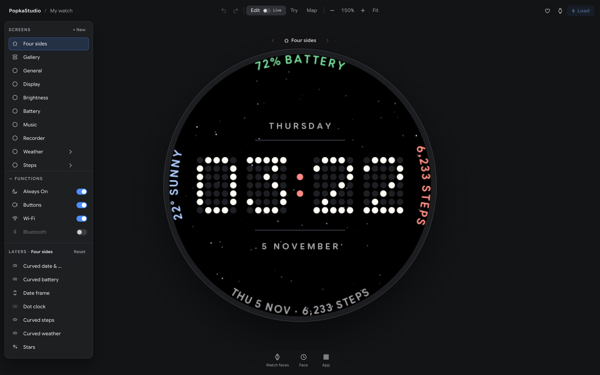
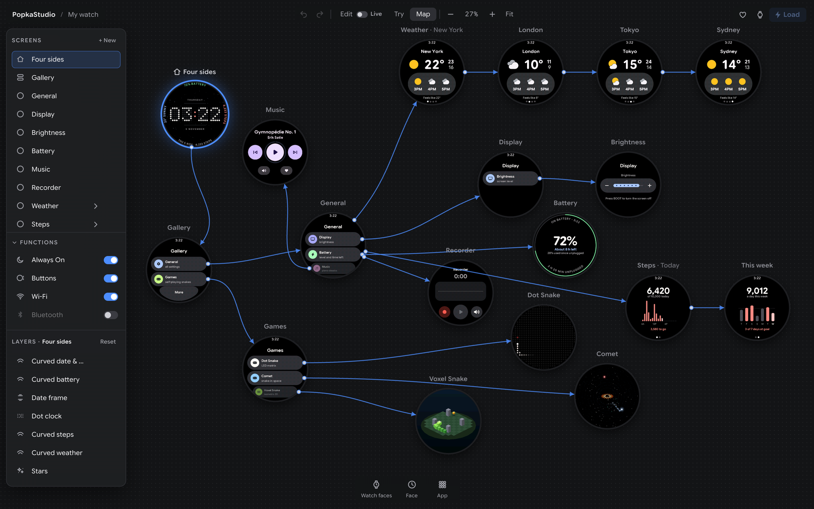
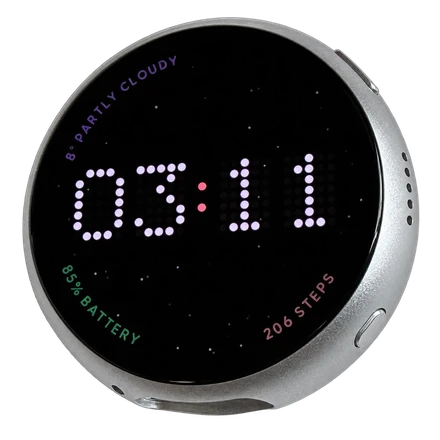
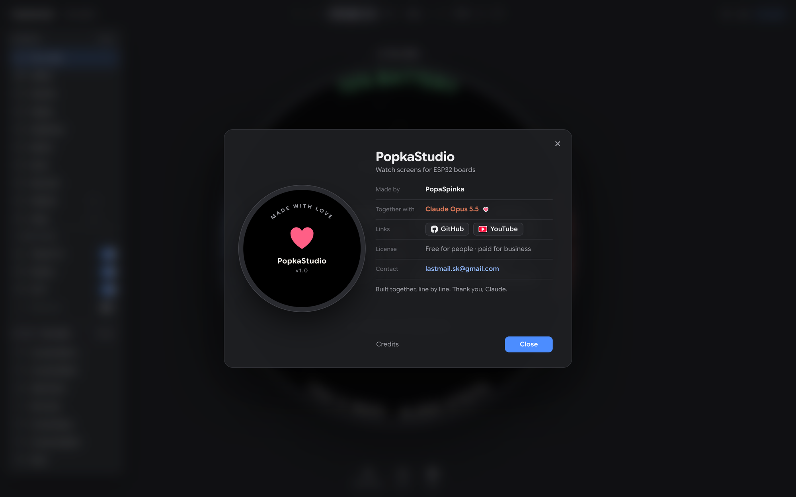

# PopkaStudio

**Экраны часов для плат ESP32 — рисуешь в браузере, на настоящих часах — одной кнопкой.**

[English](README.md) · [Видео: с чего всё началось (YouTube)](https://www.youtube.com/watch?v=7rBIQl6EG08)



PopkaStudio — редактор интерфейсов для круглых часов. Собираешь циферблат, приложения и экраны из готовых частей,
связываешь их, как кадры в Figma, и жмёшь **Load** — плата получает прошивку ровно из того, что ты сделал, и работает
плавно, 60 кадров в секунду.

Превью — не картинка-макет, а **код самой платы**, собранный в WebAssembly. Что видно в редакторе, то и на часах,
пиксель в пиксель: те же шрифты, те же анимации, то же касание.

## Что умеет

- **Циферблаты из слоёв** — большие часы, часы из точек, даты, надписи по дуге у края, погода, шаги, заряд, прогноз,
  звёздное небо с метеорами, пиксель-арт (знакомьтесь — **Попка**, попугай). Всё двигается, меняет размер и цвет;
  копий — сколько угодно.
- **Приложения** — галерея карточек (как на современных часах), погода по-настоящему и для нескольких городов, шаги
  (шагомер самого датчика движения), яркость, батарея, музыкальный плеер, диктофон и три змейки, которые играют сами.
- **Карта экранов** — все экраны сразу, связи — линиями; нажатие на карточку или слой открывает экран, с переходом.
- **Try** — пользуйся часами прямо в редакторе, мышь вместо пальца.
- **Live** — плата на USB: двигаешь и красишь — на часах меняется сразу, без Load.
- **Функции** — Always On, что делают боковые кнопки (погасить, заблокировать), чем будить: касанием, поднятием руки,
  кнопкой; Wi-Fi (точное время и свежая погода), Bluetooth.
- **В прошивку попадает только добавленное.** Что не используешь — того в прошивке нет совсем: ни кода, ни шрифтов,
  датчики выключены.



## Плата

[Waveshare ESP32-S3-Touch-AMOLED-1.75C](https://www.waveshare.com/esp32-s3-touch-amoled-1.75c.htm): круглый AMOLED
1,75″, 466 × 466, тач, датчик движения, динамик и микрофоны. Следующая — плата ESP32-P4 с экраном 7″.



## Установка — macOS и Linux

Одна команда:

```bash
curl -fsSL https://raw.githubusercontent.com/PopaSpinka/PopkaStudio/main/install.sh | bash
```

Хочешь сначала посмотреть? `git clone https://github.com/PopaSpinka/PopkaStudio.git`, прочитай `install.sh`,
запусти `./install.sh`.

Всё ставится в папку PopkaStudio (`~/PopkaStudio`), в систему — ничего: свой Python с numpy, Pillow и pyserial
([uv](https://docs.astral.sh/uv/)), [arduino-cli](https://arduino.github.io/arduino-cli/) с ядром ESP32 3.3.11 и
шрифты. Больше всего весят инструменты ESP32: 1,5–3 ГБ, первый раз 5–20 минут. На Linux один раз спросит пароль — чтобы
открыть тебе USB-порт (потом выйти из системы и войти снова).

Потом:

```bash
popkastudio
```

Откроется **http://localhost:8466**. Обновить — снова запустить `install.sh`.

Windows не поддерживается.

## Первые шаги

1. **Choose a board** — плата, потом **New** — проект.
2. Добавляй из дока внизу: **Watch faces** (циферблат целиком), **Face** (его части), **App** (приложения).
3. Подключи плату кабелем USB-C и нажми **Load** (справа вверху). Первый раз сборка идёт минуту-две, дальше быстрее.

Проекты хранятся у тебя на компьютере (`PopkaStudio/projects/`). Пароль Wi-Fi из **Functions → Wi-Fi** — тоже только
у тебя (`PopkaStudio/secrets/`) и попадает лишь в прошивку, которую собирает редактор.

Вернуть заводскую демо-прошивку — [примеры Waveshare](https://github.com/waveshareteam/ESP32-S3-Touch-AMOLED-1.75C).

## Если что-то не так

- **Платы нет в списке** — другой кабель (бывают только для зарядки). Linux: вышел и вошёл после установки? ModemManager
  в Ubuntu может занимать порт: `sudo systemctl stop ModemManager`.
- **Load не прошёл** — журнал под кнопкой Load; открой [issue](https://github.com/PopaSpinka/PopkaStudio/issues) с ним.
- **Плата зависла** — зажми PWR на 8–10 секунд и включи снова.

## Приватность

Ни аккаунтов, ни слежки. Редактор обращается только к [Open-Meteo](https://open-meteo.com) (погода выбранных городов)
и [Zippopotam.us](https://zippopotam.us) (когда ищешь американский ZIP). Часы подключаются к твоему Wi-Fi только за
временем и погодой — и только если Wi-Fi включён.

## Планы

Я буду развивать и поддерживать PopkaStudio дальше: мне нравится возиться с платами ESP32 и похожими устройствами,
делать для них красивые интерфейсы и доводить их до безупречной работы — 60 кадров в секунду и больше.

- Новые платы: следующая — ESP32-P4 с экраном 7″ (1024 × 600), потом другие круглые и квадратные экраны.
- Свой GIF или видеоролик — слоем пиксель-арта за секунды.
- Больше приложений, виджетов и циферблатов.
- Ещё плавнее движение и дольше батарея.

**Производителям плат:** хотите, чтобы ваша плата была в PopkaStudio и библиотеке Halo и работала плавно на 60+
кадрах? Пишите: **lastmail.sk@gmail.com**.

## Лицензия

[PolyForm Noncommercial 1.0.0](LICENSE): **бесплатно для себя, для хобби, учёбы и другого некоммерческого.** Продавать
устройства, прошивки, циферблаты или услуги, сделанные на PopkaStudio или Halo, — по платной лицензии: см.
[COMMERCIAL.md](COMMERCIAL.md). Часы, которые ты нарисовал, — твои.

## Благодарности



Сделал **[PopaSpinka](https://github.com/PopaSpinka)** вместе с **Claude Opus 5.5** (Anthropic) — каждый экран, каждую
пружину, каждый пиксель. Спасибо, Claude.

Код написан с нуля. Движение — по открытым опубликованным числам, ничьи прошивки и приложения не разбирались, кода из
проектов под GPL нет. Откуда что взято и под какими лицензиями чужие части — в таблицах раздела
[Credits](README.md#credits) английского README.

PopkaStudio — независимый проект, не связан с Google, Espressif и Waveshare и не одобрен ими. Wear OS и Android —
товарные знаки Google LLC; ESP32 — Espressif Systems; Waveshare — Waveshare Electronics.
